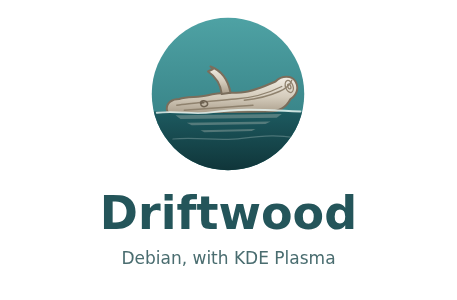

<p align="center"></p>

# Driftwood

A live/installable **Debian stable + KDE Plasma** image. Everything comes from
Debian's own archive, apart from Firefox (Mozilla's apt repository). Installed systems track
`stable`, so they move to each new Debian release with a normal upgrade.

## Images

Two ISOs are built from the same config; pick by graphics card:

- **amd**: AMD and Intel graphics (and VMs). No NVIDIA firmware or nouveau.
- **nvidia**: everything in *amd* plus nouveau and NVIDIA GPU firmware, so it
  also covers hybrid laptops (Intel/AMD + NVIDIA). NVIDIA firmware is kept out
  of the initramfs (~150 MiB); nouveau loads from the root filesystem instead.

`plasma/variants/<name>/` is overlaid on `plasma/` for each image.

## What's in it

- **Debian 13 "trixie"**, KDE Plasma 6, with kernel and firmware from Debian backports.
- **Btrfs with bootable snapshots.** Snapper takes a snapshot before and after
  every apt run, and GRUB lists them. Each snapshot keeps a copy of the kernel
  it was taken with, so it can still boot after apt has removed that kernel.
  `snapper-rollback` makes a snapshot the live system again.
  - Subvolumes: `@`, `@home`, `@root`, `@var@log`, `@var@cache`, `@var@tmp`, `@snapshots`.
  - zstd compression; `/tmp` on tmpfs.
- **Full-disk encryption** with LUKS2/argon2id, asking for the passphrase
  once. `/boot` is a separate unencrypted partition, so GRUB never decrypts anything.
- **Calamares 3.3 installer.** `tools/check-calamares.py` checks its configs against the upstream schemas.
- Flatpak (Flathub) through Discover, firmware updates through fwupd, PipeWire,
  TLP, zram swap, proprietary codecs and firmware.

## Building

The ISO is built on GitHub Actions (`.github/workflows/build.yml`) on every
push to `main`:

1. **checks:** package lists resolve against trixie, Calamares configs
   validate, and the unit tests in `tests/` pass.
2. **build:** live-build runs in a `debian:trixie` container. The run fails if the ISO is 2 GiB or bigger (the GitHub
   release-asset limit). The ISO and its checksum are uploaded as artifacts.
3. **boot:** QEMU/KVM boots the ISO three ways:
   - the kernel directly with a serial console, until Plasma is up;
   - UEFI through GRUB;
   - BIOS through isolinux.
   Screenshots and logs are kept.

**Releases:** pushing a tag `v<debian major>.<yymmdd>` (e.g. `v13.261020`)
runs the same pipeline. If both images build and all six boot tests pass,
it publishes a GitHub release with the ISOs, checksums and package lists.

To build locally (Debian trixie, root):

```sh
docker run --rm --privileged -e VARIANT=amd -v "$PWD:/src" -w /src debian:trixie ci/build-iso.sh
# -> out/Driftwood_Plasma_<version>_amd_x86-64.iso   (VARIANT=nvidia for the other)
```

## Layout

```
plasma/      live-build config (auto/, config/), build.sh
ci/          build-iso.sh (container build), boot-test.py (QEMU)
tests/       unit tests for the installer job, snapshot plugin, GRUB menu, rollback
tools/       package-list and Calamares config checks, size estimates
artwork/     logo source and the script that renders all branded images
```

## Credits

Driftwood started as a fork of **[SpiralLinux](https://github.com/SpiralLinux/SpiralLinux-project)**
by its original author. Most of the system configuration is SpiralLinux's work, carried over from its
Debian 12 Plasma spin:
- the package selection and desktop defaults;
- the Btrfs/Snapper/grub-btrfs setup and `snapper-rollback`;
- PipeWire tuning, the live-config hooks, and the Calamares setup.

Driftwood ports it to Debian 13 and Calamares 3.3, trims it to fit a single
ISO under 2 GiB, and adds the encryption, snapshot-boot and CI work described above.
The upstream project's history and Debian 12 images remain at
https://github.com/SpiralLinux/SpiralLinux-project.

Also used:
- [grub-btrfs](https://github.com/Antynea/grub-btrfs) (GPL-3.0, its own LICENSE in
  `plasma/config/includes.chroot/usr/share/grub-btrfs/`);
- [snapper-rollback](https://github.com/jrabinow/snapper-rollback), with changes
  credited in the script.

## Artwork

- **Logo** (`artwork/logo.svg`): made for Driftwood and released under
  [CC0 1.0](https://creativecommons.org/publicdomain/zero/1.0/).
- **Wallpaper** (`driftwood-wireframe-2560x1440.jpg`): a green wireframe
  landscape, supplied by the project owner; the middle third of a 7680×1440
  triple-monitor panorama.
- **Installer and boot-menu photo:** "Driftwood amongst the grasses at the
  head of Captain Cove", British Columbia, by
  [Extemporalist](https://commons.wikimedia.org/wiki/File:Driftwood_amongst_the_grasses_at_the_head_of_Captain_Cove.webp),
  CC0 1.0, via Wikimedia Commons.

`artwork/make_art.py` regenerates the boot splash, installer welcome,
slideshow and logo PNG from the logo and the photo.

**Several monitors:** `driftwood-span-wallpaper IMAGE` spreads one wide image
across all screens. It reads the monitor layout from Plasma, cuts the image
into one piece per screen (handling mixed sizes and portrait screens) and
sets them. The whole image is shown by default; `--fill` crops it to cover
every screen instead.
